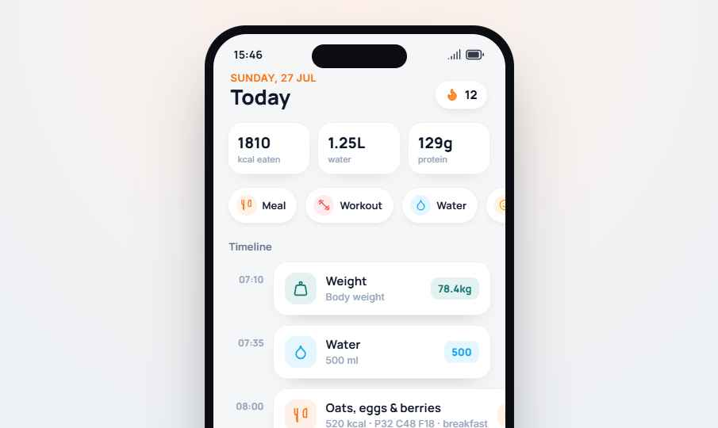

# Pulse Routine — Fitness & Meal Tracker

A mobile-first, offline-capable PWA for logging meals, water, workouts, sleep, mood, weight, spending and daily habits — with a gym strength log, friends leaderboard, reminders and an AI coach.



## Run it

No build step. Serve the folder with any static server:

```bash
python3 -m http.server 8080
# open http://localhost:8080/
```

Or use the live GitHub Pages build (deployed automatically from `main` by `.github/workflows/pages.yml`):
**https://gigiyantic.github.io/fitness-and-meal-tracker/**

On a phone, open the page and choose **Add to Home Screen** to install it as an app.

## Features

| Screen | What it does |
| --- | --- |
| **Today** | Live day countdown, year progress, kcal / water / protein totals, quick-add, timeline (tap ✕ to delete), daily habits |
| **Gym** | Exercises by muscle group, per-set logging, PR and session history charts |
| **Progress** | Last-7-days calorie chart, workouts, avg sleep, spend, goal progress |
| **Friends** | Weekly leaderboard; your score is computed from streak, workouts and habits |
| **Coach** | Chat that logs entries from plain language ("I ate 2 eggs and toast", "drank 500 ml water", "slept 7 h") and summarises your day |
| **Alerts** | Time-based or every-N-hours reminders with vibration + in-app toast |
| **Search** | Search everything you have logged, today and in past days |

## How it works

- `Routine.dc.html` — the app (template + logic in one file)
- `support.js` — the small template runtime that renders it with React
- `vendor/` — React 18 UMD builds, bundled so the app needs no CDN and works fully offline
- `sw.js` + `manifest.webmanifest` + `icons/` — PWA install and offline cache
- **Storage:** all data is saved in the browser's `localStorage` (`pulse-routine-v2`). Each entry is stamped with its date, so the Today screen starts fresh every day while history, streaks and weekly stats build up over time. First launch loads a week of demo data; delete entries or clear site data to start empty.
- **Coach:** uses `window.claude.complete` when hosted inside Claude; anywhere else it falls back to a built-in offline coach with a food-calorie table, so logging by chat always works.

## Roadmap

- Meal photo recognition (Gemini multimodal — see `.agents/skills`)
- Export / import of data
- Flutter native port

See [TECHNICAL_SPECIFICATION.md](TECHNICAL_SPECIFICATION.md) for the full spec.
