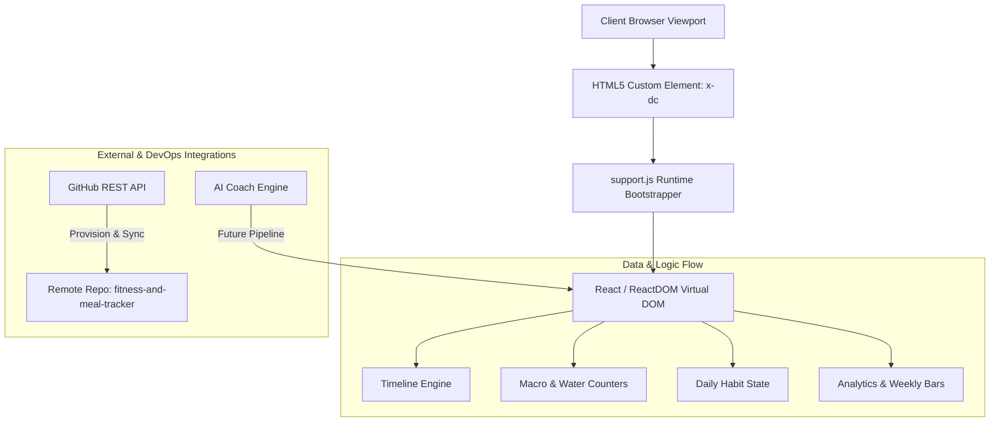

# Enterprise Technical & Business Requirements Specification (BRD / TRS)
**Project Name**: Fitness & Meal Tracker (Pulse Routine System)  
**Document Version**: 1.0.0  
**Author**: Principal Business Analyst & Lead Solutions Architect (15+ YOE)  
**Repository**: [gigiyantic/fitness-and-meal-tracker](https://github.com/gigiyantic/fitness-and-meal-tracker)  
**Date**: July 27, 2026  

---

## 1. Executive Summary & System Vision

The **Fitness & Meal Tracker** is an enterprise-grade, mobile-first wellness and performance tracking application designed to streamline daily habit enforcement, caloric/macronutrient monitoring, hydrated lifestyle tracking, and workout execution within a single unified dynamic interface.

### 1.1 Business Objectives
- **Behavioral Consistency**: Increase daily habit completion rates by providing instant feedback loops, live time-left-in-day metrics, and streak tracking.
- **Nutrition Transparency**: Simplify macronutrient logging (calories, protein, water) with zero-friction quick-add interfaces.
- **Data-Driven Progress**: Offer actionable week-over-week performance statistics and visual goal completion breakdown.
- **Extensibility**: Serve as a modular frontend ecosystem ready for integration with AI Coach recommendation logic and cross-platform mobile runtimes (Dart/Flutter).

---

## 2. Architecture & Technical Stack

### 2.1 Technology Stack Matrix

| Layer | Technology / Framework | Function & Purpose |
| :--- | :--- | :--- |
| **UI Framework** | Custom Dynamic Component Runtime (`support.js` / `x-dc`) | Light-weight React-backed virtual DOM rendering engine without bundler overhead |
| **Core Layout** | HTML5, CSS3 Custom Properties, Flexbox & Grid | Responsive mobile frame (390px x 844px viewport simulation) with glassmorphic cards |
| **Typography** | Google Fonts (`Manrope`, `Inter`) | Modern hierarchy optimized for tabular numbers, status metrics, and high legibility |
| **State Management**| Dynamic Reactive Binding Engine | Reactive template interpolations (`{{ clock }}`, `{{ calTotal }}`, `{{ habits }}`) |
| **Version Control** | Git & GitHub API Integration | Versioned repository management, remote push capabilities, PAT credential governance |

### 2.2 System Component Architecture



---

## 3. Business Domain & Functional Modules

### 3.1 Live Day Countdown & Streak Tracking Module
- **Live Clock**: Tabular numeric time rendering (`HH:MM`) calculated dynamically.
- **Time Left Tracker**: Visual countdown representing remaining hours/minutes in current day (`11h 24m left`).
- **Annual Completion Index**: Dynamic percentage bar indicating elapsed portion of current calendar year (`57% of year`).
- **Streak Maintenance**: Numeric streak badge (`Streak: 12 days`) with visual fire indicator.

### 3.2 Nutrition & Water Monitoring Module
- **Caloric Counter**: Aggregates consumed calories against target goals (`kcal eaten`).
- **Macronutrient Breakdown**: Dedicated protein monitoring in grams (`proteinTotal`).
- **Hydration Level**: Fluid intake tracking in liters/milliliters with quick-add actions (`waterLabel`).
- **Quick-Add Action Bar**: Pre-configured single-tap buttons for rapid logging (Meal, Water, Workout, Weight, Habit).

### 3.3 Timeline & Activity Log
- **Chronological Stream**: Sequential list of events sorted by timestamp (`07:30 AM`, `08:15 AM`, `12:30 PM`).
- **Categorized Badging**: Color-coded category tags with custom SVGs (Breakfast, Hydration, Gym Session, Lunch).
- **Metric Badges**: Embedded outcome indicators (`+450 kcal`, `+500 ml`, `45 min`).

### 3.4 Daily Habit Management System
- **Interactive Checklist**: Multi-item habit list (e.g., Morning Meditation, 10k Steps, Reading, Sleep by 11 PM).
- **Visual Strikethrough & State**: Toggleable state mutation featuring animated checkmarks, color shifts, and text strikethrough.

### 3.5 Weekly Analytics & Goal Tracking
- **7-Day Caloric Bar Chart**: Visual bar representation of daily intake across weekdays (Mon-Sun) with average benchmarks (`avg 2,150`).
- **Stat Cards**: Key Performance Indicators (KPIs) covering Active Minutes, Sleep Duration, Rest Heart Rate, and Workout Volume.
- **Goal Completion Breakdown**: Progress indicators for Weight Goal, Daily Water, Weekly Workouts, and Protein Target.

---

## 4. Data Dictionary & Schemas

### 4.1 Quick Add Activity Schema
```json
{
  "type": "quick_type",
  "properties": {
    "id": { "type": "string", "example": "qt_meal" },
    "label": { "type": "string", "example": "Log Meal" },
    "color": { "type": "string", "example": "#F97316" },
    "tint": { "type": "string", "example": "#FFEDD5" },
    "paths": { "type": "array", "items": { "type": "string" } }
  }
}
```

### 4.2 Timeline Entry Schema
```json
{
  "type": "timeline_entry",
  "properties": {
    "id": { "type": "string", "example": "tl_001" },
    "time": { "type": "string", "example": "07:30 AM" },
    "title": { "type": "string", "example": "Oatmeal & Protein Shake" },
    "subtitle": { "type": "string", "example": "Breakfast · 450 kcal" },
    "color": { "type": "string", "example": "#F97316" },
    "tint": { "type": "string", "example": "#FFF7ED" },
    "metric": { "type": "string", "example": "+450 kcal" }
  }
}
```

### 4.3 Habit Schema
```json
{
  "type": "habit_item",
  "properties": {
    "id": { "type": "string", "example": "h_steps" },
    "name": { "type": "string", "example": "Walk 10,000 steps" },
    "completed": { "type": "boolean", "default": false },
    "textColor": { "type": "string" },
    "strike": { "type": "string", "enum": ["none", "line-through"] }
  }
}
```

---

## 5. Security, DevOps & Git Governance

### 5.1 Remote Provisioning & Authentication Workflow
1. **Personal Access Token (PAT) Verification**: Validated token against GitHub REST API (`https://api.github.com/user`).
2. **Automated Repository Creation**: Executed HTTPS payload provisioning for `gigiyantic/fitness-and-meal-tracker`.
3. **Credential Sanitization**: Programmatically scrubbed plain-text PAT credentials from local Git remote origin URLs following push operations.
4. **Git Version Control Structure**:
   - Primary Branch: `main`
   - Ignore File Rules (`.gitignore`): Exclusion of `.thumbnail`, `*.log`, `.DS_Store`, and temporary credentials.

---

## 6. Verification & Compliance Matrix

| Requirement | Implementation Status | Verification Method |
| :--- | :--- | :--- |
| **Local Git Repository** | ✅ Completed | Executed `git init` and initial root commit |
| **Remote Repository Provisioning** | ✅ Completed | Created `gigiyantic/fitness-and-meal-tracker` via REST API |
| **Code Push & Sync** | ✅ Completed | Pushed main branch to remote origin |
| **Credential Security** | ✅ Verified | Replaced embedded PAT URL with standard HTTPS origin |
| **Technical Documentation** | ✅ Completed | Formally documented under `TECHNICAL_SPECIFICATION.md` |

---

## 7. Roadmap & Architectural Next Steps

1. **AI Coach Logic Integration**: Port `aiCoachLogic.js` rule engines into `support.js` to enable automated nutritional feedback.
2. **Flutter Cross-Platform Port**: Leverage existing Dart domain models (`lib/models/models.dart`) to ship iOS & Android native builds.
3. **Offline Sync & PWA Service Worker**: Implement IndexedDB caching for zero-latency offline habit logging.

---
*End of Document. Authored by Senior Business Analyst & Lead Architect.*
